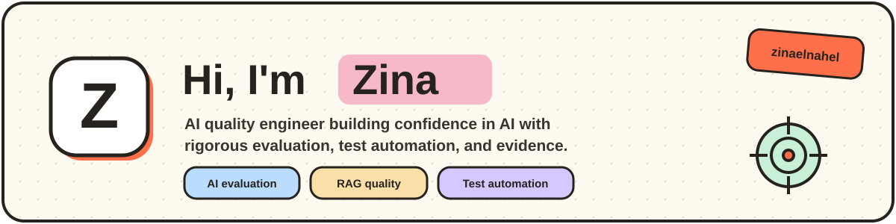
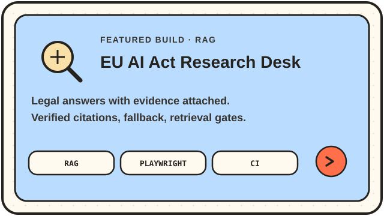
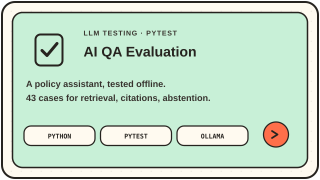
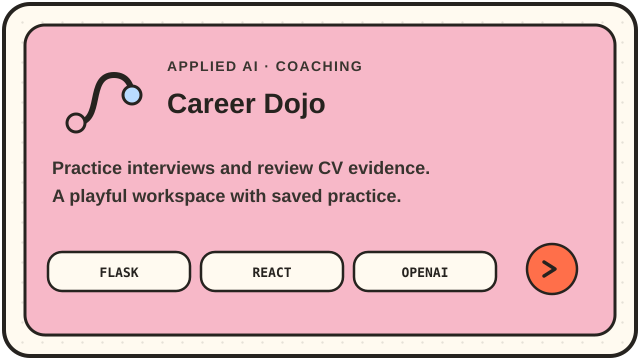
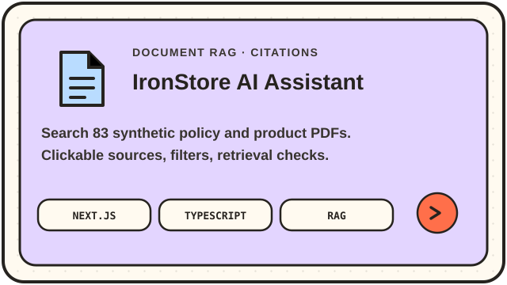

  

  
  
  
  

<b>Spain-based · Open to Spain-based and EU-remote roles</b>

<!-- contributions:start -->

  
<b>2026: 366 contributions so far</b>

   
  This contribution dashboard refreshes daily and after profile repository pushes.

<!-- contributions:end -->

### What I ship

  
  
  
  

  <a href="https://github.com/zinaelnahel/eu-ai-act-research-desk">EU AI Act source and evaluation</a> ·
  <a href="https://github.com/zinaelnahel/ai-qa-evaluation">AI QA code and reports</a> ·
  <a href="https://github.com/zinaelnahel/ai_powered_career_coach">Career Dojo source</a> ·
  <a href="https://github.com/zinaelnahel/project-brief-enterprise-ai-assistant">IronStore source</a>

### How I test AI

I build evaluation frameworks and CI quality gates for AI and web applications. My focus is **retrieval quality, citation grounding, abstention, prompt-injection checks, accessibility, performance, and production monitoring**.

  
<b>My testing approach and tools</b>

   

  - **LLM evaluation:** labeled benchmarks, retrieval precision and recall, citation checks, grounding, and abstention
  - **Frameworks:** LangSmith, DeepEval, Promptfoo, and Ragas
  - **Test automation:** Playwright, Cypress, pytest, API tests, and visual regression
  - **Performance and accessibility:** k6, Apache JMeter, Axe-core, and WCAG 2.1 AA
  - **Delivery and observability:** GitHub Actions, Datadog, Status.io, and incident.io

### A little more about me

Before software, I worked in peacebuilding and studied public policy, pharmacy, and biotechnology. I’m an ISTQB-certified engineer, a ReDI School mentor, and a lifelong language learner.

**Experience:** Senior SDET at IU IT Services · Frontend Developer and QA Engineer at Accenture  
**Education:** AI Engineering (Ironhack, 2026) · Full-stack web development · Master in Public Policy and Good Governance  
**Languages:** Arabic · German · English · Spanish · French · Italian

  
<b>More projects</b>

   

  - **SafarAI:** AI travel planning with itinerary, weather, and currency tools. [Demo](https://ai-travel-advisor-mu.vercel.app/) · [Code](https://github.com/zinaelnahel/ai_travel_advisor)
  - **Automated Customer Reviews:** NLP sentiment analysis, semantic clustering, and evidence-based article drafts. [Demo](https://review-insights-gamma.vercel.app/) · [Code](https://github.com/zinaelnahel/NLP-automated-customer-reviews)
  - **PokeFight:** team-built turn-based game with rankings. [Demo](https://pokefight-three.vercel.app/) · [Code](https://github.com/zinaelnahel/pokefight_front_end)
  - **The Rocket Coder:** full-stack React, Node.js, and MongoDB application. [Demo](https://rocketcoder.netlify.app/) · [Code](https://github.com/zinaelnahel/the_rocket_coder_frontend)

More about my work and background on <a href="https://portfoliozinaelnahel.vercel.app/">my portfolio</a>.
